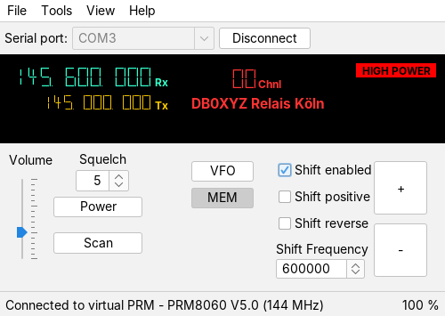

# PRM80 control software

PC software to control a **Philips/Simoco PRM8060 / PRM8070** radio
(converted for the 2 m or 70 cm amateur radio band) running the
**F4FEZ/F8EGQ/DC0CM PRM80 firmware V5.1** or newer (shift per channel,
[RaspCla/prm80](https://github.com/RaspCla/prm80)) over the serial port.
Older firmware is refused, with V5.0 the program warns about its errors.

Runs on **Windows and Linux** (and on every other system with Java 21 or newer,
e.g. macOS or a Raspberry Pi).



## Features

- Display of RX/TX frequency, channel with its comment, power, BUSY – the window can be zoomed
  freely (resize with the mouse or Ctrl + / Ctrl −)
- Channel up/down, VFO and memory mode, volume, squelch, power
- Shift: enabled, positive/negative, reverse, frequency – in VFO mode the
  frequencies change at once, in memory mode the fields show the channel
- **Write to MEM**: store the VFO setting in a memory channel (with Undo)
- **Scan** of the memory channels (channels with scan lock are skipped) or of
  a frequency range in VFO mode, stops on a signal and continues after a hold time
- **Channel manager**: read/write all channels from/to the PRM80, edit them
  (insert, delete, move, undo/redo), verify against a file,
  save as CSV file (with comments), **export as firmware configuration
  (A51 file)** for building the firmware with your own default channels
- **Configuration**: PLL step, default shift, scan speed, squelch – read/write
  from/to the PRM80, save as file (*.cfg)
- **RAM and EEPROM**: the PRM80 works with its RAM (kept some weeks without
  power); Tools > Memory > Copy RAM -> EEPROM saves all channels and settings
  permanently, Copy EEPROM -> RAM restores them
- Expert mode: restart, serial monitor,
  remote control over TCP, **virtual PRM80** (simulates firmware V5.2) for
  tests without a radio

User documentation: [control_software/trunk/README](control_software/trunk/README)  
Changes: [CHANGELOG.md](CHANGELOG.md)

## Download and installation

Ready-to-use packages are on the
[**Releases** page](../../releases/latest):

| System | File | Start |
|---|---|---|
| Windows 10/11 (64 bit) | `PRM80-<version>.msi` | installer: double click, then *PRM80* in the start menu (not signed: if Windows warns, *More info* > *Run anyway*) |
| Windows 10/11 (64 bit) | `PRM80-<version>-windows-x64.zip` | unzip anywhere, run `PRM80\PRM80.exe` |
| Debian, Ubuntu, Mint (64-bit PC) | `prm80_<version>-1_amd64.deb` | `sudo apt install ./prm80_<version>-1_amd64.deb`, then *PRM80* in the menu (Ham Radio) |
| other Linux (64-bit PC) | `PRM80-<version>-linux-x64.tar.gz` | unpack, run `PRM80/bin/PRM80` |
| any system with Java 21+ | `prm80-control-software-<version>.jar` | `java -jar prm80-control-software-<version>.jar` |

The Windows and Linux packages contain their own Java runtime – no Java
installation is needed.

**Linux:** the user needs access to the serial port:
`sudo usermod -aG dialout $USER`, then log out and in again.

## Building from source

### Tools

| Tool | Used version | Needed for |
|---|---|---|
| [JDK](https://adoptium.net) (Eclipse Temurin or any OpenJDK) | 21 (target), developed with 25 | compiling, running, `jpackage` |
| [Apache Maven](https://maven.apache.org) | 3.9 (also built into NetBeans) | build, downloads the libraries |
| [Apache NetBeans](https://netbeans.apache.org) | 2x (any current version) | IDE and GUI builder for the `.form` files (optional, any Java IDE opens the Maven project) |
| [Git](https://git-scm.com) / [TortoiseGit](https://tortoisegit.org) | | source code |
| [WiX Toolset](https://wixtoolset.org) | 3.x (JDK 21) | only for a Windows `.msi` installer |
| `dpkg-deb`, `fakeroot` (Linux) | | only for a `.deb` package |

Libraries (downloaded automatically by Maven, see `pom.xml`):

| Library | Version | Purpose |
|---|---|---|
| [jSerialComm](https://fazecast.github.io/jSerialComm/) | 2.11.4 | serial port (Windows, Linux, macOS, ARM) |
| [FlatLaf](https://www.formdev.com/flatlaf/) | 3.7.2 | look and feel, zoom of the user interface |
| AbsoluteLayout (NetBeans) | RELEASE310 | layout of the main window |

Maven plugins: maven-compiler-plugin, maven-shade-plugin (one jar with all
libraries), exec-maven-plugin (run from NetBeans, see `nbactions.xml`).

### Build and run

```
cd control_software/trunk
mvn package
java -jar target/prm80-control-software-<version>.jar
```

NetBeans: *File > Open Project* > `control_software/trunk`, then
*Clean and Build* and *Run*.

### Packages for Windows and Linux

`jpackage` (part of the JDK) builds a program folder with its own Java
runtime. It can only build packages for the system it runs on, so the
Windows package is built on Windows and the Linux package on Linux.

Windows (after `mvn package`):

```
package-windows.bat          -> target\dist\PRM80\PRM80.exe   (zip the PRM80 folder)
package-windows.bat msi      -> target\dist\PRM80-<version>.msi   (needs WiX Toolset)
```

Linux (after `mvn package`):

```
./package-linux.sh           -> target/dist/PRM80/bin/PRM80   (tar the PRM80 folder)
./package-linux.sh deb       -> target/dist/prm80_<version>-1_amd64.deb
```

The version number is taken from `<version>` in `pom.xml`.

### Automatic build on GitHub

The workflow [`.github/workflows/release.yml`](.github/workflows/release.yml)
builds everything on GitHub (Linux and Windows: jar, Windows `.msi` and
`.zip`, Linux `.deb` and `.tar.gz`):

- every push: build test, packages downloadable under *Actions > run > Artifacts*
- a tag `v<version>` (e.g. `v2.0.0`): additionally a release with all
  packages on the *Releases* page

Making a new release:

1. increase `<version>` in `control_software/trunk/pom.xml`, add the changes
   to `CHANGELOG.md`, commit and push
2. create and push the tag, e.g. `v2.0.1`
   (TortoiseGit: *Create Tag*, then *Push* with *Include Tags*)
3. after a few minutes the release with the packages appears under *Releases*

## Project structure

```
control_software/trunk/
  pom.xml                       Maven project
  nbactions.xml                 NetBeans Run/Debug settings
  package-windows.bat           Windows package (jpackage)
  package-linux.sh              Linux package (jpackage)
  packaging/                    program icon (PRM80.ico, PRM80.png, make-icon.py)
  README                        user documentation
  src/main/java/f4fez/prm80x0/
    PRM80X0App.java             start, command line options
    Controler/                  communication with the PRM80 (serial, TCP, virtual)
    gui/                        windows and dialogs (.java + .form of the GUI builder)
    A51Export.java              firmware configuration export
  src/main/resources/           images, LCD font
```

## History and credits

- **1.x** (2007–2008) Florian MAZEN, **F4FEZ** – original software
  (NetBeans/Ant, RXTX, Swing Application Framework)
- **2021** Claus Moessner – shift functions for firmware V5, channel import/export
- **2.0** (2026) Claus Moessner – modernisation: Maven, jSerialComm, FlatLaf,
  Windows and Linux, zoomable and responsive user interface, new channel manager,
  Write to MEM, A51 export for firmware V5, virtual PRM80 V5
  (developed with the help of Claude, Anthropic)
- **3.0** (2026) Claus Moessner, **DC0CM** – channel manager editing (insert,
  delete, move, undo/redo, verify), VFO follows the radio, firmware V5.1 check
  (developed with the help of Claude, Anthropic)

Modernisation and extensions since 2021: DC0CM (with the support of Claude,
Anthropic). PRM80 firmware: F4FEZ, F8EGQ, DC0CM – version 5.1:
[RaspCla/prm80](https://github.com/RaspCla/prm80).

## License

GNU General Public License v3.0 or later – see
[control_software/trunk/COPYING](control_software/trunk/COPYING).
